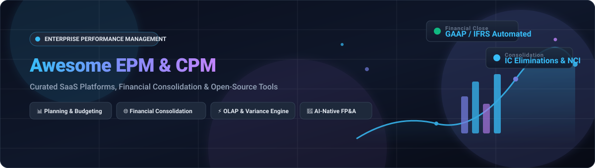
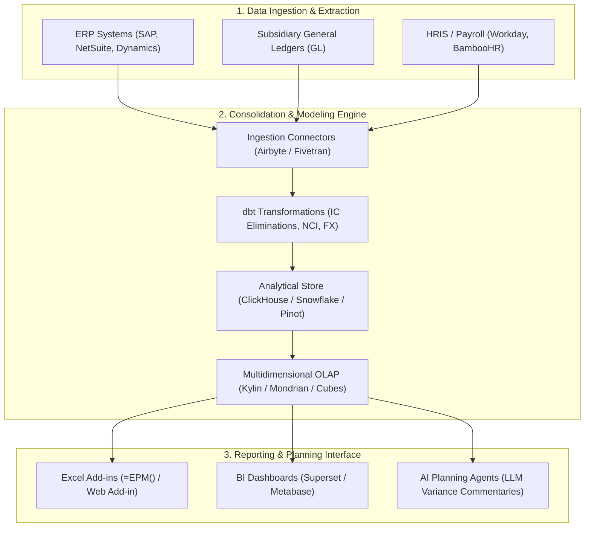

  

# 📊 Awesome Enterprise Performance Management (EPM) & CPM Software

  
  
  
  
  
  

> 🌟 A comprehensive, curated directory of the best **Enterprise Performance Management (EPM)**, **Corporate Performance Management (CPM)**, and **Financial Planning & Analysis (FP&A)** platforms, SaaS solutions, and open-source GitHub projects.

Enterprise Performance Management (EPM) and Corporate Performance Management (CPM) software empower CFOs, finance directors, controllers, and FP&A teams to automate **financial consolidation**, multi-currency reporting, budgeting, operational forecasting, intercompany elimination, month-end close management, and profitability variance analysis. 🚀

---

## 📑 Table of Contents

- [🌐 Sector Overview & Market Dynamics](#-sector-overview--market-dynamics)
- [💼 SaaS & Commercial EPM Platforms](#-saas--commercial-epm-platforms)
- [🔓 Open-Source EPM & Planning Projects](#-open-source-epm--planning-projects)
- [🏗️ Building Custom EPM & Consolidation Architectures](#️-building-custom-epm--consolidation-architectures)
- [🎯 Key Selection Criteria for Finance Leaders](#-key-selection-criteria-for-finance-leaders)
- [🤝 Contributing](#-contributing)
- [💖 Support](#-support)
- [⭐ Star History](#-star-history)
- [⚖️ Disclaimer](#️-disclaimer)

---

## 🌐 Sector Overview & Market Dynamics

📈 The global Enterprise Performance Management (EPM) software market is estimated at **$7.5 billion to $8.2 billion in 2026** (projected to surpass $15 billion to $17 billion by the mid-2030s at an annual CAGR of ~9–10%).

The sector exhibits **moderate market concentration at the top**—where multi-product enterprise giants (Oracle, SAP, Workday, and IBM) capture roughly 45%–50% of total spend through native ERP integrations—coexisting with **high fragmentation across agile pure-play vendors** (Anaplan, OneStream, Planful, Prophix, Vena, Board) that win enterprise clients seeking cross-ERP data unification, specialized financial close modeling, and connected enterprise planning.

---

## 💼 SaaS & Commercial EPM Platforms

The commercial EPM landscape is ranked below by company scale (market capitalization, private equity acquisition valuation, or annual revenue in descending order):

| Platform | Company Size (Market Cap / Valuation / ARR) | Starting Tier Pricing | Free Tier / Trial Limits | Key Strengths & Use Cases |
| :--- | :--- | :--- | :--- | :--- |
| **[Oracle Fusion Cloud EPM](https://www.oracle.com/performance-management/)** | **~$450B+ Market Cap** (Oracle Corp, NYSE: ORCL) | **$250/user/month** (Standard Edition, 10-user minimum; ~$2,500/mo per extra environment pod) | **30-day trial ($300 cloud credit)**; no permanent free tier for Fusion EPM SaaS (OCI free tier covers infrastructure only) | Full-suite enterprise planning, statutory close, IFRS/GAAP consolidation, automated account reconciliation, tax reporting, and narrative reporting. |
| **[SAP Analytics Cloud](https://www.sap.com/products/technology-platform/cloud-analytics.html)** | **~$280B+ Market Cap** (SAP SE, NYSE: SAP) | **$36/user/month** (BI tier) / **$157/user/month** (Planning tier, billed annually) | **30-day standard free trial** on shared tenant with sample data; extendable up to **90 days total** | Unified business intelligence and driver-based financial planning tightly integrated with SAP S/4HANA, ECC, and SAP BW systems. |
| **[IBM Planning Analytics](https://www.ibm.com/products/planning-analytics)** | **~$230B+ Market Cap** (IBM Corp, NYSE: IBM) | **$825/month** (Essentials cloud tier, includes 5 user seats; additional users scaling ~$165/user/mo) | **30-day full-featured trial** via Planning Analytics Workspace web/Excel interface with sample models | Ultra-high performance TM1 multidimensional in-memory calculation engine, complex driver-based modeling, and rolling scenario analysis. |
| **[Workday Adaptive Planning](https://www.workday.com/en-us/products/adaptive-planning.html)** | **~$65B+ Market Cap** (Workday Inc, NASDAQ: WDAY) | **~$25,000/year** entry-level software subscription; mid-market deployments scale $80,000–$300,000/year | **30-day guided free trial** (structured product evaluation and interactive test-drive environment) | Collaborative multi-entity budgeting, workforce head-count planning, and operational forecasting with seamless Workday Financials integration. |
| **[Anaplan](https://www.anaplan.com/)** | **$10.4B Valuation** (Thoma Bravo; ~$1B+ ARR) | **~$30,000–$50,000/year** baseline single-use case entry tier; mid-to-large enterprise contracts run $150,000–$1,000,000+/year | **No free trial or free tier**; product evaluations conducted exclusively via guided sales proofs of concept (PoC) | Proprietary Hyperblock in-memory calculation engine connecting cross-departmental planning across finance, sales quotas, and supply chain operations. |
| **[OneStream](https://www.onestream.com/)** | **$6.4B Valuation** (Acquired by Hg; ~$600M ARR) | **~$150,000/year** base platform contract (interactive named user licenses scale ~$1,200/user/year) | **No free trial or free tier**; enterprise evaluations provisioned via formal scoped Proof of Concept (PoC) | Unified Corporate Performance Management replacing legacy fragmented tools with certified financial close, consolidation, and operational planning. |
| **[Prophix](https://www.prophix.com/)** | **~$100M+ ARR** (Majority-owned by Hg) | **~$50,000/year** entry-level base configuration (~$250 to $2,500/user/year depending on role permissions) | **No permanent free tier**; interactive self-guided product tours available, with selective module trials upon sales request | Intuitive Corporate Performance Management platform for upper-mid-market finance teams, offering automated budgeting, close management, and cash flow planning. |
| **[Board](https://www.board.com/)** | **€155M Revenue (~$165M)** (Nordic Capital) | **~$50,000–$75,000/year** starting annual contract value depending on entity scope and connector setup | **No self-service free trial or free tier**; custom sandbox and live evaluation environments arranged via sales consultation | All-in-one decision-making platform blending Corporate Performance Management (CPM), BI dashboards, and simulation modeling. |
| **[Planful](https://planful.com/)** | **~$144M ARR** (Vector Capital) | **~$40,000/year** median entry contract (~$2,000–$4,000/user/year across 10–50 seats) | **No free trial or free tier**; trial instances provisioned privately during structured enterprise evaluation cycles | Continuous planning, workforce budgeting, financial close consolidation, and structured variance reporting tailored for scaling mid-market finance teams. |
| **[Vena Solutions](https://www.venasolutions.com/)** | **~$116M ARR** (Centaur status, Vista Equity backed) | **~$25,000–$35,000/year** entry subscription tier (Professional tier; multi-module Complete tiers reach $75,000–$250,000/yr) | **No free trial or free tier**; customized evaluation and live model walk-throughs conducted via sales team | Native Microsoft Excel desktop and M365 interface connected to an enterprise-grade OLAP database, audit trail, and governance workflow. |

---

## 🔓 Open-Source EPM & Planning Projects

The open-source ecosystem in EPM is characterized by specialized consolidation engines, multidimensional OLAP cubes, distributed financial analytical engines, and emerging AI-native planning agents.

The table below is sorted by GitHub Stars_Counts in descending order:

| Project & Repo | GitHub_Stars | Architecture & Core Capabilities | Primary EPM Category |
| :--- | :--- | :--- | :--- |
| **[Apache Pinot](https://github.com/apache/pinot)** |  | Distributed real-time analytical datastore (Apache 2.0) built for low-latency ad-hoc slicing, dicing, and variance calculation over massive financial data streams. | Real-Time Financial Analytics Backend |
| **[FinanceToolkit](https://github.com/JerBouma/FinanceToolkit)** |  | Transparent, modular Python toolkit (MIT) for programmatic normalization, multi-entity ratio calculation, financial statement analysis, and performance tracking. | Financial Statement & Performance Analysis |
| **[Apache Kylin](https://github.com/apache/kylin)** |  | Distributed analytical engine (Apache 2.0) providing SQL OLAP multidimensional pre-computed cubes with sub-second queries on petabyte-scale datasets. | Multidimensional OLAP Engine |
| **[Open Mercato](https://github.com/open-mercato/open-mercato)** |  | Modular open-source enterprise ERP framework (AGPL-3.0) with multi-company ledger automation, inter-company tracking, and group financial management. | Enterprise ERP & Multi-Company Ledger |
| **[Cubes](https://github.com/DataBrewery/cubes)** |  | Lightweight Python framework (MIT) for Relational OLAP (ROLAP), multidimensional hierarchical rollups, aggregated browsing, and data cube slicing. | Python Multidimensional OLAP Cube |
| **[Mondrian](https://github.com/pentaho/mondrian)** |  | Battle-tested open-source Java OLAP engine (EPL-2.0) executing MDX multidimensional queries over relational data warehouses (Mondrian ROLAP). | Java MDX OLAP Engine |
| **[Puzzle OKR](https://github.com/puzzle/okr)** |  | Open-source platform (AGPL-3.0) for Objectives & Key Results (OKRs), linking corporate strategic performance targets with departmental execution. | Operational & Strategic Performance |
| **[OpenFPA (Agent-Native)](https://github.com/JeffBrines/openfpa)** |  | Agent-native financial planning framework (Apache 2.0) featuring a finance kernel, company memory, and Karpathy-inspired iterative forecast optimization loops. | AI-Native FP&A Forecast Kernel |
| **[OpenFPA Toolkit](https://github.com/Finasis/OpenFPA)** |  | Open-source corporate FP&A toolkit providing standardized budgeting templates, rolling scenario builders, and variance management models. | Open Corporate FP&A Toolkit |
| **[FP&A AI Agent Cockpit](https://github.com/mriduldaga/Financial-Planning-and-Analysis-AI-Agent)** |  | Streamlit-based interactive cockpit for automated month-end financial close, variance commentary, dynamic scenario modeling, and executive deck creation. | AI Month-End Close & Variance Cockpit |
| **[pyfpa](https://github.com/warrenpilot/pyfpa)** |  | Python financial library providing core multidimensional data cubes, consolidation trees, and variance calculations to transition Excel spreadsheets to code. | Python Financial Cube & Variance Library |
| **[Stratus EPM](https://github.com/Maicarons/stratus-epm)** |  | Lightweight open-source group financial consolidation, budgeting, and statutory management reporting engine (Apache 2.0). | Group Financial Consolidation |
| **[Konsolidat](https://konsolidat.com/)** |  | Production-grade IFRS/GAAP consolidation engine for SAP/Dynamics environments; automated intercompany elimination, time-variant NCI ownership trees, CTA FX translation, and 26 close assertions via ClickHouse, dbt, and Excel `=EPM()` formulas. (CLI/MCP repo: `grynn-in/konsol-cli`). | Open-Source IFRS/GAAP Consolidation Engine |

---

## 🏗️ Building Custom EPM & Consolidation Architectures

Because off-the-shelf open-source software rarely provides a complete turn-key EPM suite out of the box, engineering organizations frequently assemble modern modular finance stacks:

- 📥 **Extraction & Ingestion**: ELT pipelines (Airbyte, Meltano) pull journal entries, trial balances, and operational headcount data into a unified central warehouse.
- ⚙️ **Automated Consolidation Logic**: dbt models and SQL engines handle currency translation adjustments (CTA), elimination of intercompany receivables/payables, profit-in-inventory, and non-controlling interest (NCI).
- 📊 **Presentation & Interface**: Finance analysts retain Microsoft Excel or Google Sheets connectivity using custom add-ins or Python backends while maintaining strict database governance and immutable audit logs.

---

## 🎯 Key Selection Criteria for Finance Leaders

When evaluating commercial EPM suites vs. open-source infrastructure, prioritize:

1. 🔒 **Regulatory Compliance & Auditability**: Ensure the system preserves immutable change logs, granular cell-level lineage, and automated SOX 404 audit controls.
2. ⚡ **Calculation Engine Performance**: Evaluate whether models rely on in-memory multidimensional OLAP cubes (e.g., Anaplan Hyperblock, IBM TM1) or column-store databases for instant scenario recalibration.
3. 🔌 **ERP Interoperability**: Gauge out-of-the-box bi-directional connectors for your transactional ERPs (SAP S/4HANA, Oracle ERP Cloud, Microsoft Dynamics 365, NetSuite).
4. 💰 **Implementation Time & Total Cost of Ownership (TCO)**: Factor in software license costs, external implementation partner fees (often 100%–150% of Year 1 software), and internal maintenance headcounts.

---

## 🤝 Contributing

Contributions and additions to this curated index are welcome!

1. 🍴 Fork this repository.
2. 🌿 Create a descriptive feature branch (`git checkout -b feature/add-new-epm-tool`).
3. 📝 Add the project with verified pricing, company scale, and Stars_Counts matching the table formats.
4. 🔍 Ensure links and markdown formatting pass validation.
5. 🚀 Open a Pull Request detailing your changes.

---

## 💖 Support

If you find this repository helpful for your enterprise architecture research or FP&A workflows, please consider supporting the project:

- ⭐ **Star this repository** to help others discover it!
- 🍴 **Fork and contribute** new tools, corrections, or implementation guides.
- 📢 **Share with finance & engineering peers** exploring EPM, CPM, and consolidation stacks.
- ☕ **Buy a coffee or sponsor ongoing maintenance**: Support via the [GitHub Sponsors Dashboard](https://github.com/sponsors/ishandutta2007) ❤️

---

##  Star History

---

## ⚖️ Disclaimer

This repository is an open community-curated directory intended for research, architectural planning, and educational purposes. Product pricing, licensing terms, and valuation benchmarks are subject to ongoing change by respective vendors. Always confirm specific licensing terms directly with vendor sales representatives or official project documentation before production deployment.
